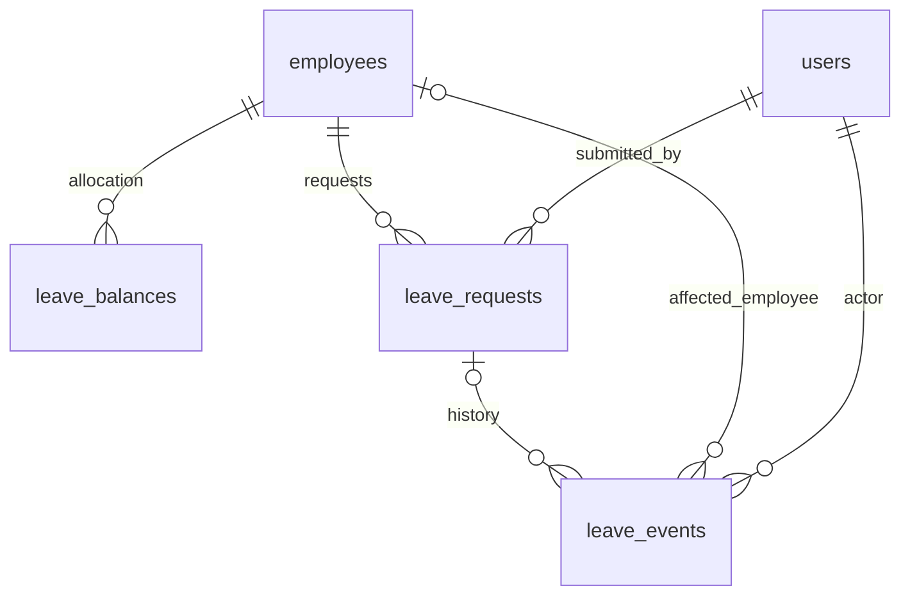
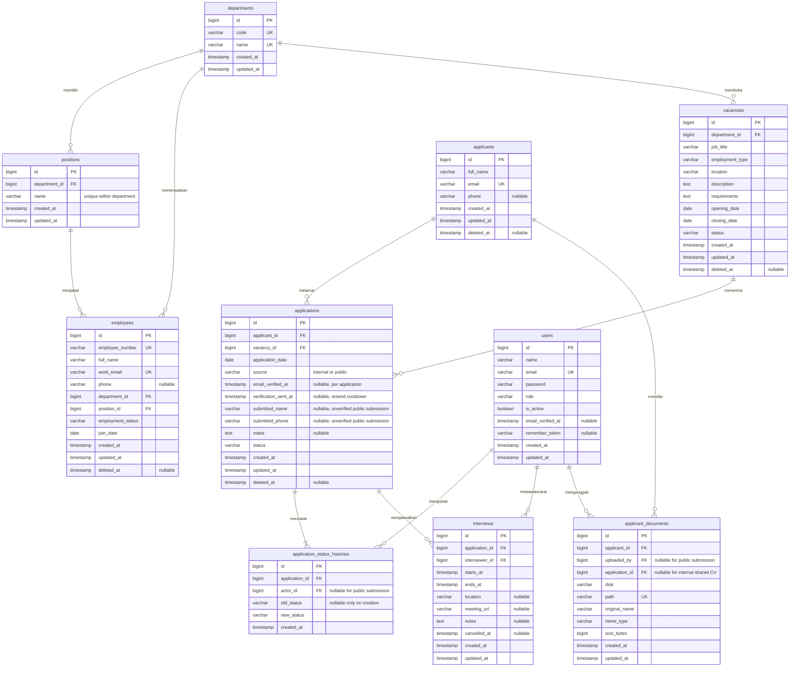
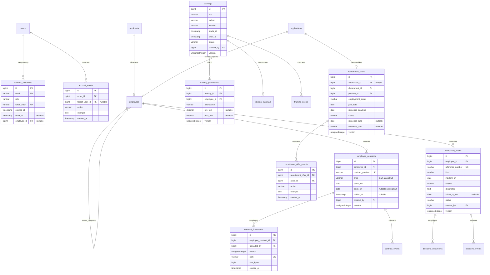

# HRIS Lite — ERD dan rancangan migration

Pembaruan jadwal massal: tidak menambah schema. AttendanceSchedules memakai attendance_days unique employee/date dan attendance_events yang ada; audit changes menambah batch_id UUID, reason dan snapshot. Preview stateless encrypted token mencakup actor_id/auth_version/input/fingerprint/expiry15menit; row preview tidak dipercaya saat commit. Mutex akun lalu current employee/day locks terurut melindungi actor, status/join pegawai, row existing dan overlap tanggal sekitar; snapshot juga mencakup libur dan approved/cancel_pending work_dates. Seluruh jadwal+audit satu transaksi, tidak overwrite termasuk row voided. Tidak tabel pola shift atau auto-check-in.

Pembaruan kalender kehadiran: migration000014 menambah `attendance_days` (employee_id FK RESTRICT + date WIB unique, scheduled_start/end UTC, clock_in/out UTC nullable, tolerance_minutes0–120, version, voided_at nullable, timestampsUTC) dan `attendance_events` append-only (attendance_day_id/actor_id FK RESTRICT, action, changesJSON before/after/reason, created_atUTC). CHECK durasi jadwal>0≤24jam dan urutan punch/durasi≤24jam. Lock mutex akun→pegawai→day, unique employee/date menjaga duplikasi; overlap punch lintas tanggal ditolak service. Tidak mengubah row cuti: kalender membaca approved/cancel_pending.work_dates snapshot dan libur kantor; data absensi kosong tetap unknown. Koreksi/pembatalan beralasan menjaga snapshot historis, tidak hard delete. Tidak menambah tabel fingerprint/GPS/payroll atau jadwal default.

Pembaruan cuti/izin: migration000013 menambah `leave_balances` (employee_id FK RESTRICT + year unique, days0–366, version, timestamps), `leave_holidays` (date unique, name150, created_at), `leave_requests` (employee_id/submitted_by FK RESTRICT, type annual/sick/permission, status pending_supervisor/pending_hr/approved/rejected/cancel_pending/cancelled, starts_on/ends_on date WIB, year/days, work_dates JSON snapshot, reason privat, document_path/bytes nullable privat, version, timestamps UTC), `leave_events` append-only (leave_request_id/employee_id nullable FK RESTRICT, actor_id FK, action, changes JSON, created_at UTC). CHECK jenis/status/hari/periode, indeks employee+year+status dan status+starts_on. Tidak hard delete pengajuan; hapus hari libur tetap mencatat snapshot audit. Tidak tabel counter saldo terpisah: jumlah terpakai/tertahan dihitung dari pengajuan aktif. Mutasi lock singleton akun lalu pegawai/pengajuan; eligibility pegawai/atasan memakai current locking read agar perubahan status/arsip tidak lolos lewat snapshot lama. Disk leave_documents privat; props/ekspor tidak mengirim path. Rollback migration menolak jika ada data/riwayat.

Pembaruan akun: migration000012 menambah users.is_active defaulttrue, employee_id nullable unique FK RESTRICT, version/auth_version default1; employees.manager_employee_id nullable FK RESTRICT ke employees; account_invitations.employee_id nullable FK/version. account_administration_lock singleton id1 menyerialisasi mutasi akun/undangan/aktivasi/reset/struktur atasan; account_events append-only (actor/target_user/employee/invitation FK nullable RESTRICT, action, changes JSON, created_at UTC; tanpa password/token). Tidak ada CHECK self-manager karena MySQL menolak rujukan kolom auto_increment; self/cycle dicegah traversal service di bawah mutex/rowlock. Undangan aktif mereservasi pegawai lewat pemeriksaan transaksi, users.employee_id unique tetap menjaga satu akun per pegawai. Reset memakai password_reset_tokens bawaan (hash/expiry/single use) di transaksi yang sama. Role dan batas portal ditegakkan backend.

Pembaruan pelanggaran/SP: migration000011 menambah disciplinary_cases (employee_id FK RESTRICT, reference_number unique100, kind violation/sp1/sp2/sp3/counseling, incident_on date WIB, subject255, description privat, follow_up_on date nullable>=kejadian, status open/resolved/voided, version, created_by FK, timestamps UTC), discipline_documents (disciplinary_case_id+version unique, uploaded_by FK, UUID path unique, size1–5MiB, created_at UTC), discipline_events append-only (disciplinary_case_id, actor_id FK, action, changes JSON before/after/reason, created_at UTC). CHECK jenis/status/periode/file. Pegawai/jenis immutable; lock pegawai lalu catatan menyerialisasi koreksi/status/alokasi versi. Tidak ada tabel laporan baru: query terbatas dari applications, training_participants+trainings, employee_contracts dan disciplinary_cases dengan kolom terpilih. Ekspor sementara, tidak menyalin uraian/telepon/email/path/audit. Viewer tidak mengakses modul SP dan laporan.

Pembaruan kontrak: migration000010 menambah employee_contracts (employee_id FK RESTRICT, contract_number unique100, type pkwt/pkwtt, starts_on/ends_on date, notes privat, voided_at UTC, created_by FK, version, timestamps UTC), contract_documents (employee_contract_id+version unique, uploaded_by FK, UUID path unique, size_bytes1–5MiB, created_at), contract_events append-only (employee_contract_id, actor_id FK, action, changes JSON snapshot, created_at UTC). CHECK PKWT wajib akhir>=mulai; PKWTT akhir null. Semua FK RESTRICT. Lock pegawai lalu kontrak menyerialisasi pengecekan overlap periode inklusif serta alokasi versi dokumen; pegawai immutable. Koreksi/pembatalan wajib alasan dan versi. Disk contract_documents privat; data Viewer tidak berisi notes/path/berkas/audit. Tanggal kalender WIB; pengingat mengecualikan pegawai arsip/nonaktif dan kontrak dengan perpanjangan tanpa jeda. Tidak otomatis mengubah status pegawai.

Pembaruan Pelatihan: migration000009 menambah trainings (judul, pemateri, lokasi, waktu UTC, scheduled/completed/cancelled, notes privat, version, created_by FK), training_participants (training_id+employee_id unique, attendance registered/attended/absent, pre_test/post_test decimal5,2 nullable0–100, notes, version), training_materials (training_id+version unique, uploaded_by, UUID path unique, size_bytes≤5MiB, created_at), training_events (training_id, actor_id, action, changes JSON, created_at; append-only). FK RESTRICT; CHECK waktu, status, skor dan pasangan post-test. Materi disk privat; metadata tidak mengirim path. Pegawai relasi peserta memakai withTrashed untuk riwayat. Waktu sesi tidak dapat dipindah setelah nilai pernah muncul pada audit, meskipun nilai kini kosong. Rata-rata hanya pasangan lengkap peserta hadir, selisih post−pre dalam poin.

Pembaruan Offering: migration000008 menyediakan recruitment_offers (application_id unique, department/position FK gabungan, employment_status, join_date, response_deadline, terms nullable, status pending/accepted/declined/withdrawn, response_date/response_note/evidence_path/evidence_size nullable, timestamps UTC). recruitment_offer_events append-only: recruitment_offer_id, actor_id FK RESTRICT, action, changes JSON snapshot, created_at UTC. Employees menambah applicant_id dan source_application_id nullable+unique+FK RESTRICT, mencegah duplikasi konversi termasuk arsip. Tanggal berupa date WIB, file respons privat. Application.version mengunci revisi/respons; konversi memakai lock aplikasi/profil dan unique DB. Rollback migration ditolak bila ada penawaran/hasil konversi untuk menjaga audit.

Pembaruan verifikasi lamaran publik: migration000007 menambah applications.email_verified_at dan verification_sent_at nullable (UTC). Verifikasi per lamaran, tanpa perubahan profil pelamar atau user internal; HR tidak dapat mengubah tahap lamaran publik sebelum verified. Pekerjaan email terenkripsi memakai tabel jobs Laravel pada koneksi database aplikasi yang sama agar ikut transaksi. Lihat EMAIL-VERIFICATION-PLAN.md.

Status: seluruh migration `000001`–`000012` sudah executable dan diterapkan pada database development tanpa reset. Diagram pertama merangkum skema inti; tabel modul lanjutan dirangkum pada diagram kedua. Baca [PLAN.md](PLAN.md) untuk business rules dan scope.

Pembaruan ATS: migration000004 menyediakan applicants, applications (version integer), application_status_histories (note nullable) dan applicant_documents. Path CV privat disimpan di DB; disk/MIME/nama unduh ditetapkan server secara tetap, bukan kolom disk/original_name/mime_type pada rancangan awal. Unique email dan pasangan profil/lowongan, FK RESTRICT, timestamps UTC. Jadwal interview, arsip, pipeline database, dan portal karier publik sudah tersedia.

Pembaruan lowongan: migration000003 menyediakan vacancies dengan version integer serta CHECK tanggal/status/jenis kerja. Lowongan internal dapat ditambah/dibaca/diedit/ditutup; tidak ada hard delete karena riwayat lamaran harus dipertahankan. Lowongan published tampil di `/karier` dalam periode WIB inklusif. Daftar aktif memakai tanggal WIB, penyimpanan timestamp tetap UTC.

Pembaruan pegawai 2 November: departments, positions dan employees sudah executable pada migration000002. Employees menambah version unsigned integer untuk konflik formulir. Employee_events menyimpan employee_id FK, actor_id FK, action, reason nullable, changes JSON nullable, document_path unik nullable, document_size nullable dan created_at UTC. FK hard delete RESTRICT; file disk privat. Arsip/restore melalui UI Admin tersedia; rancangan awal yang menunda restore dikesampingkan untuk pegawai. Seluruh tabel domain rekrutmen, kontrak, pelatihan, dan disiplin sudah executable.

Pembaruan autentikasi: migration `2026_11_02_000001` menambah `users.role` (default viewer) dan tabel `account_invitations`: id, email unik, role, token_hash unik, expires_at, used_at nullable, timestamps UTC. Migration lanjutan `000012` menambah `users.employee_id`, `is_active`, `version`, `auth_version`, `employees.manager_employee_id`, `account_invitations.employee_id/version`, `account_administration_lock`, dan `account_events`. Token undangan mentah hanya disampaikan ke penerima; database menyimpan hash SHA-256, bukan token.

## Diagram modul lanjutan

## Konvensi kolom dan integritas

- Semua id unsigned bigint auto-increment; FK unsigned bigint, InnoDB, utf8mb4. Semua kolom wajib kecuali ditandai nullable. Timestamps UTC; date tidak dikonversi zona waktu.
- String default 255, phone 32, role/status 32, employee_number/code 50, meeting_url 2048. Email disimpan lowercase dan unique; validasi tetap mempertahankan constraint database untuk race conditions.
- `users.role`: admin/hr_staff/viewer/employee/supervisor, default viewer; `is_active` default true. Akun employee/supervisor wajib terhubung unik ke pegawai aktif. Akun dinonaktifkan, bukan hard delete, agar actor audit tetap valid. Session middleware menolak akun nonaktif dan memeriksa `auth_version`.
- `employees.employment_status`: permanent/contract/probation/intern/inactive. `vacancies.employment_type`: full_time/part_time/contract/internship. Keduanya domain terpisah dan label UI Indonesia.
- `vacancies.status`: draft/published/closed, default draft. `applications.status`: screening/interview/offering/accepted/rejected, default screening. Gunakan PHP backed enums dan CHECK database untuk daftar nilai serta rentang tanggal di MySQL yang mendukung enforced CHECK.
- `positions`: unique (department_id, name) dan unique (id, department_id). `employees` mempunyai FK department_id serta FK gabungan (position_id, department_id) ke positions(id, department_id), sehingga jabatan departemen lain ditolak database juga.
- `applications`: unique (applicant_id, vacancy_id), termasuk ketika diarsip. Tidak ada reapply/reopen pada MVP. `application_date` dan notes milik aplikasi, bukan identitas kandidat.
- `application_status_histories`: append-only; tanpa updated_at atau soft delete. Creation history old_status null; pengajuan publik actor_id null, setiap transisi HR mencatat actor session dan waktu. Kardinalitas minimal satu history dijamin service transaction, bukan FK saja.
- `applicant_documents`: satu row per versi CV, file UUID unik, disk privat yang ditetapkan server. CV publik mempunyai application_id dan uploaded_by null; akses dibatasi ke lamaran itu. CV internal dengan application_id null dapat dibagikan lintas lamaran profil. UI menampilkan versi terbaru dan daftar versi hanya kepada admin/HR. Path/original_name tidak pernah menjadi path input unduh.
- Pengajuan publik menyimpan nama/telepon belum terverifikasi pada applications, tanpa menimpa profil yang sudah ada. Migration000006 menolak rollback jika masih ada data publik/actor null agar audit tidak hilang.
- FK menggunakan RESTRICT pada hard delete; master departemen/jabatan tidak dihapus jika direferensikan. Tidak ada cascade hard delete audit atau file. Penghapusan employee/vacancy/applicant berarti soft delete; kandidat diarsip beserta aplikasi dan pembatalan interview mendatang secara transaksional. Lowongan arsip menolak aplikasi baru namun history tetap terbaca.
- Wawancara dihapus secara logis lewat cancelled_at; jangan hilangkan rekam jejak jadwal. Listing aktif mengecualikan cancelled_at dan induk arsip. Blok bentrok jadwal dengan transaction + lock user interviewer, lalu cek overlap starts_at < proposed_end dan ends_at > proposed_start.
- Unique email/nomor pegawai tidak dilepas saat soft delete; validasi menjelaskan bahwa nilai telah dipakai. Restore dan hard delete bukan scope UI MVP.

## Index dan constraint tambahan

| Tabel | Index/check |
| --- | --- |
| employees | (department_id, employment_status), full_name, join_date; FK gabungan position/department |
| vacancies | (status, opening_date, closing_date), department_id; closing_date >= opening_date |
| applicants | full_name, unique email |
| applications | unique (applicant_id, vacancy_id), (vacancy_id, status), (status, application_date) |
| application_status_histories | (application_id, created_at, id); actor FK; index created_at untuk aktivitas terbaru |
| interviews | (interviewer_id, starts_at, ends_at), (application_id, starts_at), starts_at; ends_at > starts_at |
| applicant_documents | (applicant_id, created_at), unique path; size_bytes > 0 dan <= 5242880 |

Pencarian substring `%term%` terikat parameter, sesuai ukuran demo; index nama tidak diklaim mempercepat semua substring. Jika skala bertambah, ukur query sebelum menambah full-text. Sorting SQL hanya dari whitelist, bukan nama kolom bebas dari request.

## Urutan migration

1. `000001` — role, status akun, undangan, dan struktur atasan.
2. `000002` — departments, positions, employees, employee_events.
3. `000003` — vacancies.
4. `000004` — applicants, applications, application_status_histories, applicant_documents.
5. `000005` — interviews.
6. `000006` — dukungan lamaran publik.
7. `000007` — verifikasi email lamaran.
8. `000008` — recruitment_offers dan konversi pegawai.
9. `000009` — trainings, participants, materials, events.
10. `000010` — employee_contracts, documents, events.
11. `000011` — disciplinary_cases, documents, events.
12. `000012` — account management lock/events dan kolom akun lanjutan.

Down migration berjalan dalam urutan terbalik. Jangan menjalankan `migrate:fresh` pada database pengguna yang sudah berisi data.

## Seed demo

`DatabaseSeeder` menjalankan master data pada semua environment dan `DemoSeeder` hanya pada `local`/`testing`. Data demo saat ini: 5 departemen, 10 jabatan, 25 pegawai, 6 lowongan, 20 pelamar, 30 lamaran dengan riwayat tahap, 8 interview, 8 kontrak (termasuk PKWT jatuh tempo/berakhir), 3 pelatihan dengan peserta/nilai, 3 catatan pelanggaran/SP/konseling, dan penawaran untuk lamaran Offering/Diterima. Seeder idempotent dan memakai `firstOrCreate`/unique key. Akun demo `admin@example.test`, `hr@example.test`, `viewer@example.test`, `atasan@example.test`, dan `pegawai@example.test` hanya dibuat di local/testing; password default dapat diganti lewat `DEMO_PASSWORD`. README dan DEMO mendokumentasikan detailnya.

Pembaruan interview: migration000005 menambah interviews sesuai rancangan ditambah created_by, cancelled_by, cancel_reason dan version integer. Waktu UTC ditampilkan WIB. Pembatalan mempertahankan row; belum ada hard delete atau edit langsung.
