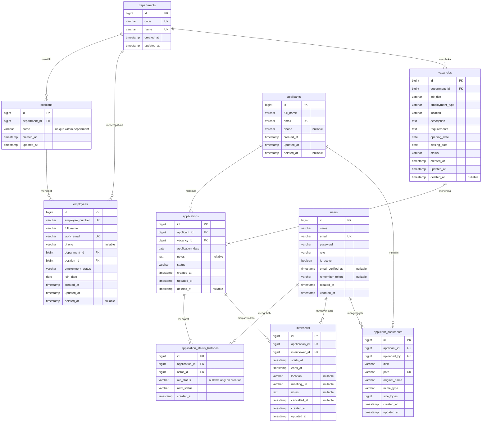

# HRIS Lite — ERD dan rancangan migration

Status: usulan Phase 1, belum migration executable. Baca [PLAN.md](PLAN.md) untuk business rules dan scope.

Pembaruan ATS: migration000004 menyediakan applicants, applications (version integer), application_status_histories (note nullable) dan applicant_documents. Path CV privat disimpan di DB; disk/MIME/nama unduh ditetapkan server secara tetap, bukan kolom disk/original_name/mime_type pada rancangan awal. Unique email dan pasangan profil/lowongan, FK RESTRICT, timestamps UTC. Jadwal interview dan arsip domain ini belum tersedia.

Pembaruan lowongan: migration000003 menyediakan vacancies dengan version integer serta CHECK tanggal/status/jenis kerja. Lowongan internal sudah dapat tambah/baca/edit/status; belum ada hapus/arsip lowongan di UI, halaman karier atau tabel kandidat/aplikasi. Daftar aktif memakai tanggal WIB, penyimpanan timestamp tetap UTC.

Pembaruan pegawai 2 November: departments, positions dan employees sudah executable pada migration000002. Employees menambah version unsigned integer untuk konflik formulir. Employee_events menyimpan employee_id FK, actor_id FK, action, reason nullable, changes JSON nullable, document_path unik nullable, document_size nullable dan created_at UTC. FK hard delete RESTRICT; file disk privat. Arsip/restore melalui UI Admin sekarang tersedia sesuai permintaan terbaru; rancangan awal yang menunda restore dikesampingkan untuk pegawai. Domain rekrutmen di bawah masih rancangan.

Pembaruan autentikasi: migration `2026_11_02_000001` menambah `users.role` (default viewer) dan tabel `account_invitations`: id, email unik, role, token_hash unik, expires_at, used_at nullable, timestamps UTC. Tabel domain di bawah masih rancangan. Token undangan mentah hanya disampaikan ke penerima; database menyimpan hash SHA-256, bukan token.

## Konvensi kolom dan integritas

- Semua id unsigned bigint auto-increment; FK unsigned bigint, InnoDB, utf8mb4. Semua kolom wajib kecuali ditandai nullable. Timestamps UTC; date tidak dikonversi zona waktu.
- String default 255, phone 32, role/status 32, employee_number/code 50, meeting_url 2048. Email disimpan lowercase dan unique; validasi tetap mempertahankan constraint database untuk race conditions.
- `users.role`: admin/hr_staff/viewer, default viewer; `is_active` default true. Akun dinonaktifkan, bukan hard delete, agar actor audit tetap valid. Session middleware menolak akun nonaktif.
- `employees.employment_status`: permanent/contract/probation/intern/inactive. `vacancies.employment_type`: full_time/part_time/contract/internship. Keduanya domain terpisah dan label UI Indonesia.
- `vacancies.status`: draft/published/closed, default draft. `applications.status`: screening/interview/offering/accepted/rejected, default screening. Gunakan PHP backed enums dan CHECK database untuk daftar nilai serta rentang tanggal di MySQL yang mendukung enforced CHECK.
- `positions`: unique (department_id, name) dan unique (id, department_id). `employees` mempunyai FK department_id serta FK gabungan (position_id, department_id) ke positions(id, department_id), sehingga jabatan departemen lain ditolak database juga.
- `applications`: unique (applicant_id, vacancy_id), termasuk ketika diarsip. Tidak ada reapply/reopen pada MVP. `application_date` dan notes milik aplikasi, bukan identitas kandidat.
- `application_status_histories`: append-only; tanpa updated_at atau soft delete. Creation history old_status null; setiap transisi mencatat actor session dan waktu. Kardinalitas minimal satu history dijamin service transaction, bukan FK saja.
- `applicant_documents`: satu row per versi CV, file UUID unik, disk privat yang ditetapkan server. UI menampilkan versi terbaru dan daftar versi hanya kepada admin/HR. Path/original_name tidak pernah menjadi path input unduh.
- FK menggunakan RESTRICT pada hard delete; master departemen/jabatan tidak dihapus jika direferensikan. Tidak ada cascade hard delete audit atau file. Penghapusan employee/vacancy/applicant berarti soft delete; kandidat diarsip beserta aplikasi dan pembatalan interview mendatang secara transaksional. Lowongan arsip menolak aplikasi baru namun history tetap terbaca.
- Wawancara dihapus secara logis lewat cancelled_at; jangan hilangkan rekam jejak jadwal. Listing aktif mengecualikan cancelled_at dan induk arsip. Blok bentrok jadwal dengan transaction + lock user interviewer, lalu cek overlap starts_at < proposed_end dan ends_at > proposed_start.
- Unique email/nomor pegawai tidak dilepas saat soft delete; validasi menjelaskan bahwa nilai telah dipakai. Restore dan hard delete bukan scope UI MVP.

## Index dan constraint tambahan

| Tabel | Index/check |
| --- | --- |
| employees | (department_id, employment_status), full_name, join_date; FK gabungan position/department |
| vacancies | (status, opening_date, closing_date), department_id; closing_date >= opening_date |
| applicants | full_name, unique email |
| applications | unique (applicant_id, vacancy_id), (vacancy_id, status), (status, application_date) |
| application_status_histories | (application_id, created_at, id); actor FK; index created_at untuk aktivitas terbaru |
| interviews | (interviewer_id, starts_at, ends_at), (application_id, starts_at), starts_at; ends_at > starts_at |
| applicant_documents | (applicant_id, created_at), unique path; size_bytes > 0 dan <= 5242880 |

Pencarian substring `%term%` terikat parameter, sesuai ukuran demo; index nama tidak diklaim mempercepat semua substring. Jika skala bertambah, ukur query sebelum menambah full-text. Sorting SQL hanya dari whitelist, bukan nama kolom bebas dari request.

## Urutan migration yang direncanakan

1. users (adaptasi migration Laravel), session dan tabel pendukung framework yang benar-benar dipakai.
2. departments.
3. positions dengan composite unique keys.
4. employees beserta composite FK.
5. vacancies.
6. applicants.
7. applications.
8. application_status_histories.
9. interviews.
10. applicant_documents.

Down migration berjalan dalam urutan terbalik. Setiap migration mempunyai nama timestamp Laravel sesuai urutan ini. Jangan menjalankan migrate:fresh pada database user yang sudah berisi data.

## Seed yang diusulkan

3 akun role demo, 5 departemen, 10 jabatan, 30 pegawai, 6 lowongan berbagai status, 24 kandidat, 30 aplikasi dengan seluruh tahapan pipeline, dan 8 interview (termasuk riwayat/pembatalan). Seeder membuat history yang konsisten melalui workflow domain; interview mendatang hanya untuk tahap interview. CV fixture berupa PDF sintetis tanpa data nyata. Password berasal dari env development; README mendokumentasikan email demo dan cara menentukan password lokal.

Tidak ada tabel kontrak pada MVP. Dashboard tidak menampilkan preview kontrak sampai schema dan scope kontrak disetujui terpisah.
